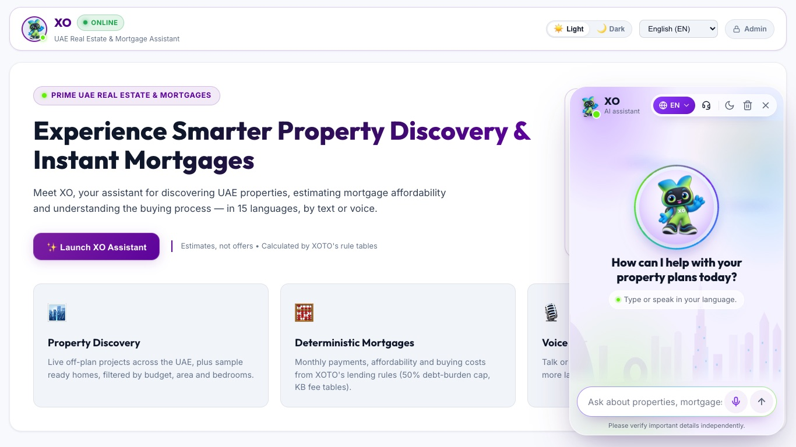
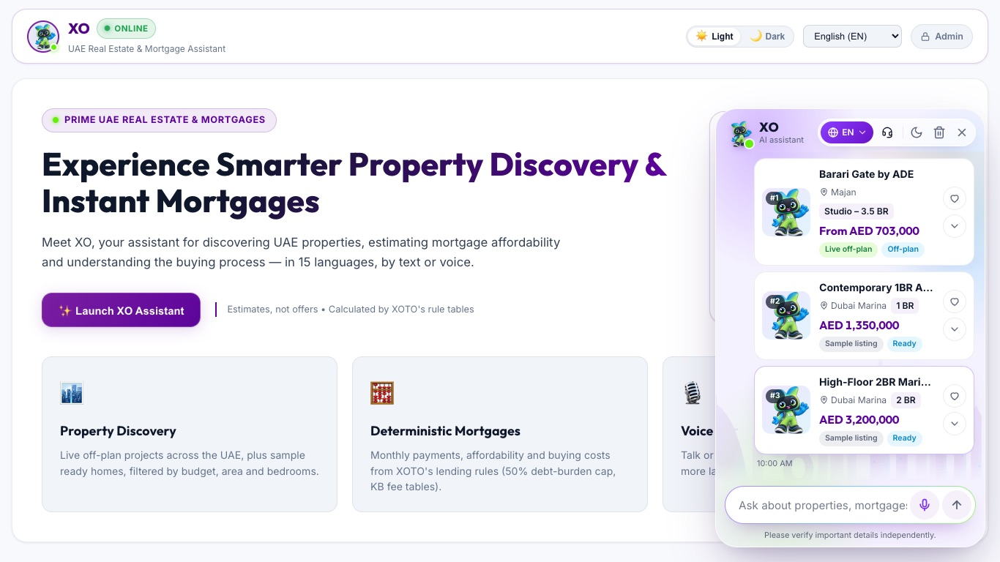
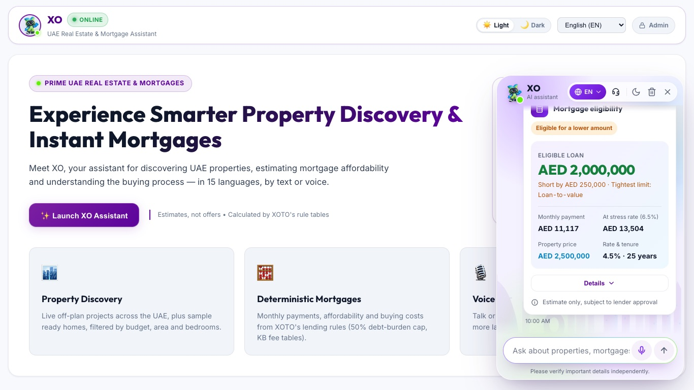
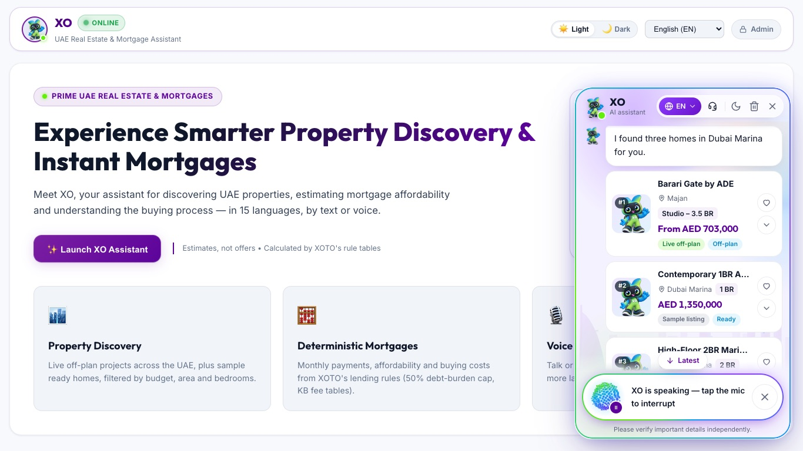
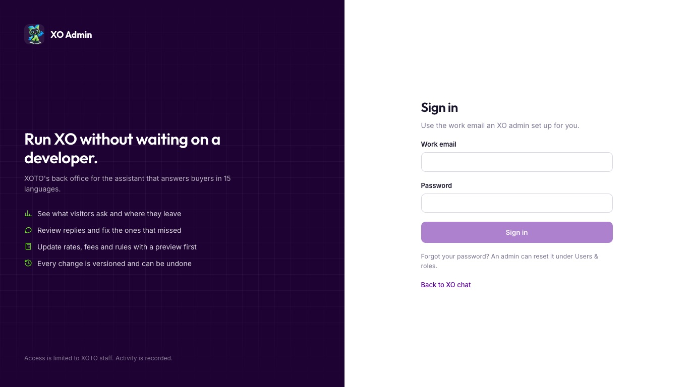
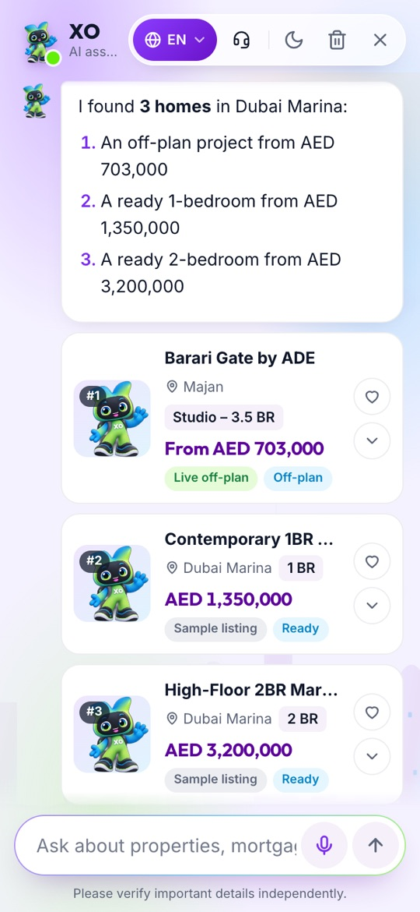
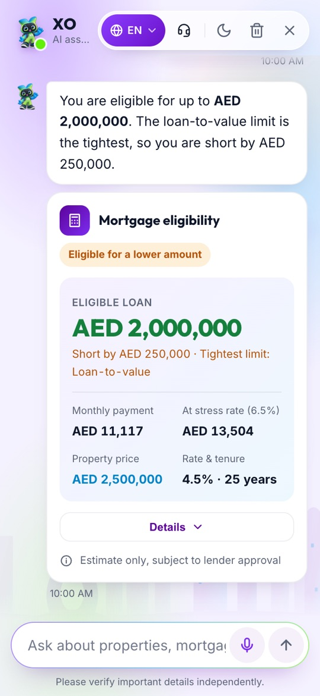
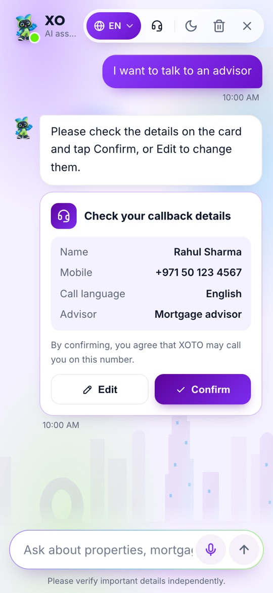
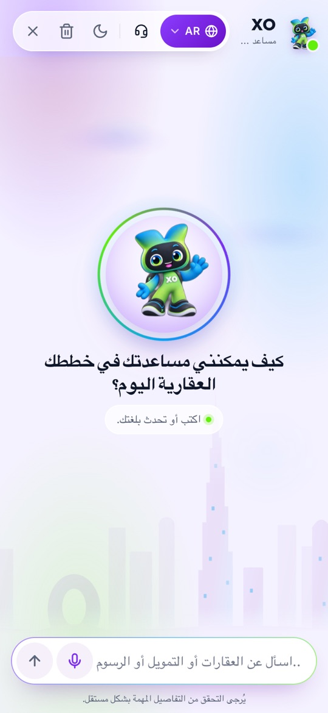
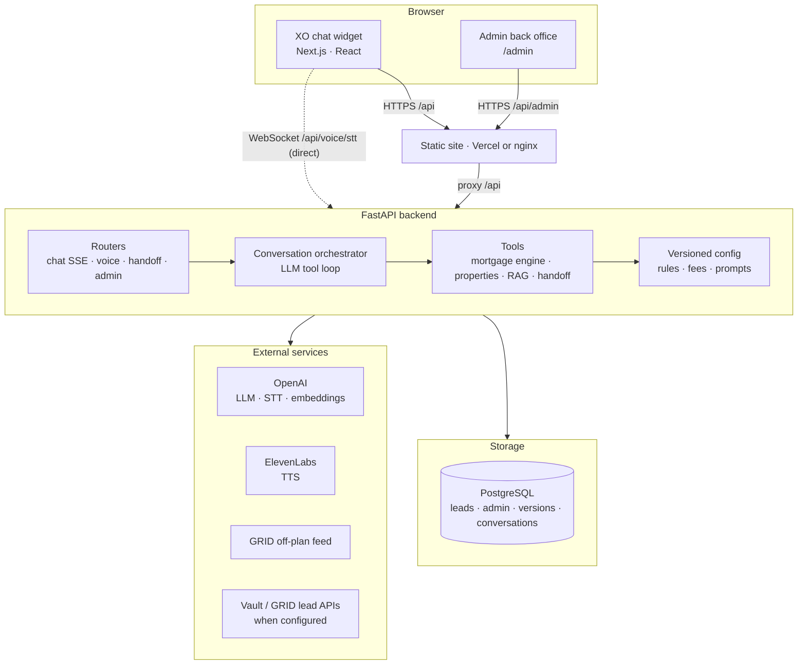

<div align="center">


# XO — XOTO Conversational Assistant

**A multilingual chat and voice assistant for UAE real estate and mortgages, with an admin back office.**

[](https://nextjs.org/)
[](https://react.dev/)
[](https://www.python.org/)
[](https://fastapi.tiangolo.com/)
[](https://www.postgresql.org/)
[](https://platform.openai.com/)
[](https://elevenlabs.io/)
[](docker-compose.yml)
[](e2e/)
[](#tests)



[Features](#features) · [Screenshots](#screenshots) · [Architecture](#architecture) · [Getting started](#getting-started)

</div>

> **Note:** Company documents and the knowledge base are private and not included.

## Overview

XO is XOTO's chat and voice assistant for UAE real estate and mortgages. It helps buyers, investors, agents, brokers, bankers and mortgage advisors find properties, estimate affordability and payments, understand fees and regulations from XOTO's knowledge base, and request an advisor callback, in 21 languages.

**The problem it solves:** buying property in the UAE means comparing listings, working out what a bank will lend, adding up purchase fees and understanding local rules, often in a second language. XO answers these questions in one conversation, by text or voice, in the visitor's own language. Every number comes from deterministic calculators and approved rule tables, not from the language model. When a visitor needs a person, XO collects their consent and contact details and passes the request to the right advisor team.

**Who it is for:**

- **Visitors:** buyers, investors, agents, brokers, bankers and mortgage advisors using the chat widget.
- **XOTO staff:** admins, bot trainers, content editors and analysts using the back office at `/admin`.

**Project documents:** The authoritative requirements are in `prd.md` and `Xobia_KB_v2_FINAL.md` (private, not included); mortgage eligibility and calculations follow the approved `Mortgage Eligibility Calculations.pdf` (private, not included).

## Features

| Feature | What it does |
|---|---|
| Streaming chat | Replies stream token by token over Server-Sent Events, rendered as markdown with HTML disabled. |
| Live voice | Speech is transcribed live with captions; replies are spoken back with the current word highlighted, shown with a 3D voice orb. The visitor can interrupt by tapping the mic. |
| Property discovery | Searches a live GRID off-plan feed plus sample ready listings, with strict filters (budget, area, bedrooms), similar listings, comparison and a shortlist. |
| Mortgage calculators | Affordability, monthly payment (EMI), eligibility and purchase costs, calculated by a deterministic engine from versioned rule, fee and rate tables. |
| Knowledge-base answers | Retrieval-augmented answers from XOTO's knowledge base; when nothing relevant is found, XO says so and offers an advisor. |
| Advisor callback | A consent-gated card where the visitor checks or edits their name, number and call language before confirming; the lead is saved to PostgreSQL and routed to the mortgage or sales team. |
| 21 languages | Interface text and replies in 21 languages, including right-to-left layouts for Arabic, Urdu and Persian; the language can be switched at any time. |
| Light and dark theme | The widget and the demo page support both themes. |
| Reply ratings | Visitors can rate each finished reply as helpful or not helpful. |
| Privacy and cost protection | Card numbers, IBANs and CVVs are removed before text reaches the model; names and phone numbers are masked in logs; per-visitor and global rate limits protect paid AI calls. |
| Admin: analytics | Volume, handled by XO, lead conversion, satisfaction, cost per conversation, topics, drop-off points, languages and a monthly AI budget alert. |
| Admin: conversation review | Transcripts with filters, per-reply notes, a review queue and corrected answers saved as knowledge drafts. |
| Admin: knowledge base | Articles and glossary terms with versions; PDF, Word, CSV and web-page import, screened for instruction-like text. |
| Admin: bot tuning, rules and escalation | Edit XO's persona, canned replies, banned topics, lending rules, fees, bank products and escalation rules as drafts, then publish with a note; every version can be restored. |
| Admin: users, roles and activity | Four roles checked on every request, and an activity log of every change with who made it. |

## Screenshots

### Desktop (1366 px)

| | |
|---|---|
|  |  |
| Property results with live off-plan and sample listings | Mortgage eligibility card with the tightest limit explained |
|  |  |
| Voice mode while XO is speaking | Admin back office sign-in |

### Mobile (360 px)

| | | | |
|---|---|---|---|
|  |  |  |  |
| Property results | Mortgage eligibility | Advisor callback | Arabic, right to left |

Screenshots were taken from a local build with the test suite's simulated backend, so they show sample data only.

## Tech stack

| Area | Technology |
|---|---|
| Frontend | Next.js 16.3.8 (static export), React 19.2.8, markdown-it 14.1.0, plain CSS |
| Backend | Python 3.11 (Docker image), FastAPI, Uvicorn, Pydantic 2, httpx, websockets, NumPy (vector search), pypdf, python-docx, phonenumbers |
| Database | PostgreSQL 16 through asyncpg; falls back to in-process memory when `DATABASE_URL` is not set |
| AI services | OpenAI (language model, speech-to-text, embeddings), ElevenLabs (text-to-speech) |
| Testing | Python `unittest` (backend), Playwright 1.48.2 (frontend, desktop, Android and iPhone) |
| Tooling | Docker and Docker Compose, nginx, Vercel (frontend), Render (backend) |

### Models (confirmed, override PRD §6.2)

| Purpose | Model |
|---|---|
| LLM | OpenAI `gpt-6-luna` (reasoning effort `none`, function calling) |
| Speech-to-text | OpenAI `gpt-live-transcribe` (Realtime transcription session, streamed through the backend) |
| Text-to-speech | ElevenLabs `eleven_v4_turbo`, voice Horatius `qXpMhyvQqiRxWQs4qSSB` |
| Embeddings (RAG) | OpenAI `text-embedding-3-small` |

All model names come from environment variables. See [`.env.example`](.env.example).

## Architecture



### How it works

```
Browser widget (Next.js / React)
  ├─ POST /api/chat/stream  (SSE: session → status → tokens → final)
  ├─ WS   /api/voice/stt    (24 kHz PCM → gpt-live-transcribe → live captions)
  ├─ POST /api/handoff/confirm (advisor callback card: user confirms or edits → saved to the PostgreSQL lead store)
  ├─ POST /api/voice/speak-timed (reply pieces → eleven_v4_turbo MP3 + word timings; played while streaming, spoken word highlighted)
  └─ POST /api/voice/speak  (plain MP3 stream)

Conversation orchestrator (FastAPI)
  ├─ gpt-6-luna with function calling (multi-step tool loop, real token streaming)
  ├─ Tools: search_properties · get_listing_details · find_similar · compare_listings
  │         calc_affordability · calc_emi · check_eligibility · calc_purchase_costs
  │         get_lending_rules · get_mortgage_products · estimate_offers · retrieve_kb
  │         get_service_pricing · shortlist_property · get_my_saved_properties
  │         get_my_application_status · request_human_handoff · set_language
  ├─ Mortgage engine — deterministic, reads versioned rule/fee/rate tables (no LLM math)
  ├─ Property discovery — live GRID off-plan feed + sample ready listings
  ├─ RAG — embeddings → vector search → passages → model answer (or "I don't know" + advisor)
  └─ Handoff — consent-gated, saved to PostgreSQL, routed to Vault (mortgage) or GRID (sales)
```

The LLM understands intent, details, language and consent from the conversation. Every number, listing, rule and fact comes from a tool. Nothing is invented.

### Repository

```
.
├── backend/
│   ├── app/
│   │   ├── admin/          roles, accounts, activity log, analytics, review, knowledge base, published versions
│   │   ├── core/           settings, security, audit and usage tracking
│   │   ├── data/config/    versioned business data and prompts
│   │   ├── db/             shared PostgreSQL layer, leads, saved conversations
│   │   ├── gateways/       GRID off-plan feed, services, Vault and GRID lead APIs
│   │   ├── llm/            language model client
│   │   ├── orchestrator/   engine, tools, sessions
│   │   ├── routers/        HTTP and WebSocket endpoints
│   │   ├── services/       mortgage engine, properties, RAG, handoff, escalation
│   │   ├── voice/          speech-to-text and text-to-speech
│   │   └── main.py
│   ├── tests/
│   ├── Dockerfile
│   └── requirements.txt
├── frontend/
│   ├── src/
│   │   ├── app/            Next.js entry (/ and /admin)
│   │   ├── xo/             the self-contained chat widget
│   │   ├── shell/          demo page around the widget
│   │   ├── admin/          admin app
│   │   └── styles/
│   ├── public/
│   ├── Dockerfile
│   ├── nginx.conf
│   └── vercel.json
├── e2e/                    Playwright tests with a simulated backend
├── scripts/                knowledge-base ingestion, vector store, cost and catalog exports
├── branding/               mascot and brand guide
├── docs/screenshots/       images used in this README
├── docker-compose.yml
└── .env.example
```

- `backend/app/` holds the FastAPI app: `orchestrator/` (engine, tools, sessions), `services/`, `gateways/`, `voice/`, `routers/`, `core/`, `db/` and `data/`.
- `frontend/src/xo/` holds the widget, self-contained so it can be moved into another Next.js site: `components/` (`ChatWidget.jsx`, `MessageItem.jsx`, `MortgageCard.jsx`, `HandoffCard.jsx`, `VoiceOrb.jsx` for the 3D voice orb, …), `hooks/useVoice.js` and `lib/voice.js` (live STT), `lib/speech.js` (streamed TTS playback), `lib/wordHighlight.js` (marks the spoken word), `i18n/ui.json` (21-language UI text), `lib/api.js`, `lib/markdown.js` and `styles/`.
- `frontend/src/shell/` holds the demo page around the widget (header, landing page, admin preview); `frontend/src/app/` is the Next.js entry (`/` widget, `/admin` back office).
- `frontend/src/admin/` holds the admin app (sign-in, navigation, pages, `styles/admin.css` with `xa-` classes), kept separate from the widget. `backend/app/admin/` holds roles, accounts and the activity log; `backend/app/db/` the shared PostgreSQL layer and saved conversations.
- `e2e/` holds the frontend tests (Playwright, simulated backend): desktop, Android and iPhone, 13 screen sizes and screenshot comparison. Run `cd e2e && npm install && npx playwright install && BASE_URL=http://localhost:3000 npm test`.
- `docs/IMPLEMENTATION_PLAN.md` (private, not included) is the remediation plan these changes follow.

## Key engineering decisions

- **The language model never does the maths.** It reads intent, details, language and consent, then calls tools. Every figure comes from a deterministic mortgage engine that reads versioned rule, fee and rate tables, and it is tested against 15 approved cases to the dirham.
- **Business rules are data, not code.** Rules, fees, bank products, prompts, canned replies and escalation rules live in versioned files. Admins edit them as drafts and publish them with a note. Every backend instance picks up published versions from PostgreSQL within 30 seconds, and any version can be restored.
- **Leads are saved before they are forwarded.** A confirmed callback is written to PostgreSQL first and only then sent to the Vault or GRID lead API, so a failed CRM call does not lose the lead. Nothing is sent without the visitor's explicit confirmation.
- **Nothing the client says about identity is trusted.** Identity comes only from signed HS256 tokens with separate audiences for visitors and admins. The visitor's address is read only from the hops added by the site's own proxies, and paid AI calls have a per-visitor limit plus a shared ceiling.
- **The widget is portable and the site is static.** The widget lives in one self-contained folder and the frontend is a static export, so it runs on Vercel or nginx. Live voice opens its WebSocket straight to the backend because Vercel rewrites cannot proxy WebSockets.
- **Frontend tests run against a simulated backend.** The Playwright suite answers every API call from captured fixtures, so runs are fast, free and repeatable on desktop, Android and iPhone, with screenshot comparison.

## Getting started

### Prerequisites

- Python 3.11 (the version in the backend Docker image)
- Node.js 20.9 or later (required by Next.js 16)
- PostgreSQL 16, optional for local development (without `DATABASE_URL`, data is kept in memory)
- OpenAI and ElevenLabs API keys for real chat and voice replies

### Environment variables

Copy [`.env.example`](.env.example) to `backend/.env` and fill in the values. Names only:

| Group | Variables |
|---|---|
| App | `ENVIRONMENT`, `PORT`, `ALLOWED_ORIGINS`, `ENABLE_API_DOCS`, `MAX_REQUEST_BYTES`, `MAX_UPLOAD_REQUEST_BYTES` |
| AI keys and models | `OPENAI_API_KEY`, `ELEVENLABS_API_KEY`, `LLM_MODEL`, `LLM_REASONING_EFFORT`, `STT_MODEL`, `TTS_MODEL`, `EMBEDDING_MODEL`, `ELEVENLABS_VOICE_ID`, `ELEVENLABS_VOICE_NAME` |
| Conversation and voice tuning | `VOICE_SILENCE_SUBMIT_MS`, `STT_DELAY`, `STT_NOISE_REDUCTION`, `TTS_MAX_CHARS`, `LLM_MAX_OUTPUT_TOKENS`, `LLM_MAX_TOOL_STEPS`, `HISTORY_MAX_MESSAGES`, `SEARCH_MAX_RESULTS`, `RAG_TOP_K`, `RAG_MIN_SIMILARITY` |
| Security and limits | `ADMIN_API_KEY`, `JWT_SECRET`, `RATE_LIMIT_PER_MINUTE`, `TRUSTED_PROXY_HOPS`, `GLOBAL_PAID_CALLS_PER_MINUTE` |
| Admin module | `ADMIN_BOOTSTRAP_EMAIL`, `ADMIN_BOOTSTRAP_PASSWORD`, `ADMIN_SESSION_HOURS`, `ADMIN_LOGIN_ATTEMPTS_PER_15_MIN` |
| Integrations | `GRID_OFFPLAN_API_URL`, `OFFPLAN_LISTING_URL_TEMPLATE`, `GRID_API_URL`, `GRID_API_KEY`, `VAULT_API_URL`, `VAULT_API_KEY` |
| Database | `DATABASE_URL`, `POSTGRES_PASSWORD` |
| Compliance | `COMPANY_RETENTION_POLICY_REF`, `REGULATORY_SCOPE` |
| Frontend (build time) | `NEXT_PUBLIC_API_BASE`, `NEXT_PUBLIC_API_WS_BASE`, `DEV_API_TARGET` |
| Tests | `TEST_DATABASE_URL`, `BASE_URL`, `ADMIN_E2E_EMAIL`, `ADMIN_E2E_PASSWORD` |

### Running locally

```bash
cp .env.example backend/.env        # add your keys
cd backend && pip install -r requirements.txt
uvicorn app.main:app --port 8000

cd frontend && npm install && npm run dev   # http://localhost:3000 (proxies /api; live voice connects to ws://127.0.0.1:8000, see frontend/.env.development)
```

`npm run build` writes a static site to `frontend/out/`, which nginx (Docker) or Vercel serves.

With Docker: set `POSTGRES_PASSWORD` and your keys in `.env`, then run `docker compose up --build`.

### Deployment notes

- **Backend (Render):** set every variable from `.env.example`. `ALLOWED_ORIGINS` must include the frontend origin, for example `https://xoto-blitz.vercel.app`. Set `DATABASE_URL`, or leads, admin accounts and saved conversations are kept in memory only.
- **Admin pages:** nginx serves `/admin` from `admin.html` (`try_files … $uri.html`) and `frontend/vercel.json` rewrites `/admin` to `/admin.html`.
- **Frontend (Vercel):** set `NEXT_PUBLIC_API_WS_BASE=wss://<backend-host>` (the old `VITE_API_WS_BASE` is still read). Vercel rewrites cannot proxy WebSockets, and live voice connects directly to the backend. The project's framework preset is Next.js (`frontend/vercel.json`).
- **Off-plan links:** set `OFFPLAN_LISTING_URL_TEMPLATE` (for example `https://xoto.ae/<path>/{slug}`) to show "View details". Without it, no link is shown.

### Tests

```bash
cd backend && python -m unittest discover -s tests -t .
```

The offline tests (223, of which 10 need PostgreSQL) cover:
- the mortgage engine against the 15 approved test cases (to the dirham), the KB's worked examples and the rule tables;
- property search (strict filters, ranges, alternatives, live-feed parsing);
- security (auth, admin key, CORS, rate limits, voice origin check, payment redaction, no leaks);
- the orchestrator, using a fake streaming LLM (tool loop, memory, language guard, failure handling);
- handoff truthfulness, voice text cleaning and RAG scoping;
- the admin module: sign-in, sessions, every endpoint against every role, user rules, activity log, saved conversations.

> In this public repository the private knowledge base is not included, so the 23 tests that read it stop with an error. The other 190 pass, and the 10 PostgreSQL tests are skipped unless `TEST_DATABASE_URL` is set.

The PostgreSQL tests run when `TEST_DATABASE_URL` points at a throwaway database: `TEST_DATABASE_URL=postgresql://… python -m unittest tests.test_admin_postgres`.

Admin browser tests need a backend with a first admin, served on the same origin as the frontend. They try wrong passwords on purpose, so give that test backend `ADMIN_LOGIN_ATTEMPTS_PER_15_MIN=1000` to avoid the lock-out across repeated runs:
`cd e2e && ADMIN_E2E_EMAIL=… ADMIN_E2E_PASSWORD=… BASE_URL=http://… npx playwright test admin admin-insights admin-editing`. `admin-editing` puts every setting it changes back to the built-in version.
`admin-insights` sends one real chat message through the widget, so that backend needs working model keys.

## More details

### Business data (no code changes needed)

Everything business-specific lives in versioned files under [`backend/app/data/config/`](backend/app/data/config/):

| File | Contents |
|---|---|
| `mortgage_rules.json` | Approved eligibility rules: bank settings (age, minimum income, stress test, card-limit debt, non-resident LTV), Central Bank values (50% debt burden, 25-year term, income multiple, rent vacancy), ordered LTV table, benchmark rate |
| `fees.json` | Purchase fees by emirate (KB Article 2) |
| `bank_products.json` | Indicative bank products (pending Mortgage Team confirmation) |
| `communities.json` | Communities, emirates and their aliases |
| `inventory_sample.json` | Sample ready listings for the prototype (off-plan is live) |
| `locales.json` | 21 languages: STT/TTS codes, server messages |
| `services_pricing.json` | Service quotations |
| `pricing.json` | Provider prices for cost monitoring |
| `prompts/system_prompt.md` | XO's persona and conversation rules |

These files are the built-in versions. Rules, fees, bank products, instructions, canned replies, escalation rules and the knowledge base can be changed in the admin module instead; a published version there takes priority, and restoring version 0 goes back to the file. After editing a file, call `POST /api/admin/reload-config` (header `X-Admin-Key`) to apply it without a redeploy. Open mortgage questions for the Mortgage Team are in `XO_Mortgage_Policy_Review.xlsx` (private, not included).

### Security & privacy

- Identity comes only from a signed bearer token (HS256, `JWT_SECRET`). Client headers are never trusted.
- Transcripts, leads, usage and audit logs are only available under `/api/admin/*`, to signed-in admins whose role allows it, or to scripts with `X-Admin-Key`.
- Card numbers, IBANs and CVVs are removed before any text reaches the model. XO never handles payments.
- Phone numbers and names are masked in logs. CORS is restricted to `ALLOWED_ORIGINS`, and endpoints that spend credits are rate-limited.
- Chat text is rendered as markdown with HTML disabled, so no script injection is possible.

### Admin module (Phase 7, in progress)

The back office (PRD §5.6) is at `/admin` on the same site as the widget, e.g. `https://xoto-blitz.vercel.app/admin`.

- **First sign-in:** set `JWT_SECRET`, `DATABASE_URL`, `ADMIN_BOOTSTRAP_EMAIL` and `ADMIN_BOOTSTRAP_PASSWORD` on the backend. On start-up, if no Admin exists, that account is created. Sign in, then add everyone else under **Users & roles**.
- **Roles (FR-30):** Admin, Bot trainer, Content editor, Read-only analyst. The server checks the role on every request; the UI only hides what a role cannot use. See `backend/app/admin/permissions.py`.
- **Sessions:** an HttpOnly, SameSite=Strict cookie limited to `/api/admin`. Signing out ends that browser's session; a password change, role change or deactivation ends all of that person's sessions. Only failed sign-ins count towards the lock-out (8 per 15 minutes per address and per account).
- **Activity log:** every admin change is recorded with who made it.
- **Conversations** are saved per turn (in the background) for review and analytics.
- **Analytics** (FR-31): volume, handled by XO, lead conversion, satisfaction (visitor helpful / not helpful ratings), cost per conversation, topics, drop-off points, languages, channels, top questions, and a monthly AI budget with an alert (Admins set it).
- **Conversation review** (FR-26): search and filters, transcripts, good/bad/flag/note per reply, a review queue of flagged replies and replies rated not helpful, and corrected answers saved as knowledge drafts. Phone numbers and emails are masked for roles without access to leads.
- **Widget:** visitors can rate each finished XO reply as helpful or not helpful (`POST /api/chat/feedback`, accepted only for real replies of a live session).
- **Knowledge base** (FR-24, Content editor and up): articles and glossary terms with tags, versions, removal and restore; PDF, Word and CSV import; web pages from approved sites (default `xoto.ae`) refreshed weekly; review reminders; corrected answers from conversation review; "Try a question" to see what XO would answer from. Uploaded files and pages are screened for text that reads like instructions to an AI.
- **Bot tuning** (FR-25, Bot trainer and Admin): persona, open instruction sections, guided journeys, tone per language, banned topics (blocked before the AI runs), canned replies, and a test chat with the draft. The four sections that carry PRD rules are locked.
- **Calculator rules** (FR-27, Admins): rates, terms, eligibility, affordability limits, loan-to-value percentages, fees and bank products, with an impact check over the 15 approved cases before publishing.
- **Escalation rules** (FR-29, Bot trainer and Admin): when XO offers a callback (visitor asks — always on, no answer found, sensitive words, high-value enquiry, frustration) and which team it goes to; queue names per team.
- Every editor works as draft → publish with a note → numbered version, applied from the next message, with one-click restore. Published versions are stored in PostgreSQL and picked up by every backend instance within 30 seconds.
- Built so far: 7A (accounts, roles, activity log, saved conversations, admin shell), 7B (analytics, review, ratings) and 7C (the editors above, plus a redesign of the whole admin). Integrations, translations and A/B tests (7D) show as "Coming soon". Progress is tracked in `docs/IMPLEMENTATION_PLAN.md` (private, not included).

## Author

**Siraj Munir** · [github.com/SirajMunir10](https://github.com/SirajMunir10)
